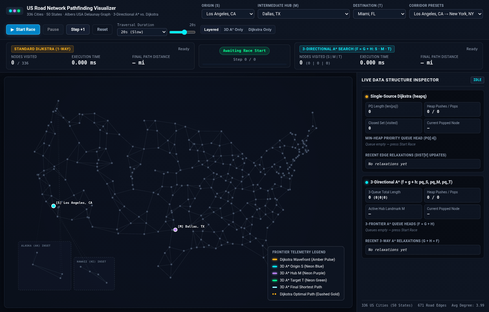

# US Road Network Pathfinding : 3-Directional A* vs. Dijkstra

[](https://us-road-pathfinding-visualizer-296730842549.us-central1.run.app)
[](https://www.python.org/)
[](https://fastapi.tiangolo.com/)

Interactive full-stack pathfinding visualizer comparing **3-Directional A\* Search ($f = g + h$)** against **Standard Single-Source Dijkstra's Algorithm** across a **336-city US road network graph** spanning all 50 states.

🔗 **Live link**: [https://us-road-pathfinding-visualizer-296730842549.us-central1.run.app](https://us-road-pathfinding-visualizer-27yc3666da-uc.a.run.app/)

---

## 🎬 Los Angeles ($S$) → Dallas ($M$) → Miami ($T$)

> **Traversal (`Los Angeles, CA` → `Miami, FL` via Intermediate Hub `Dallas, TX`)**:
> Watch **3-Directional A\* Search** simultaneously expand three heuristic-guided wavefronts — **Origin $S$ (`Los Angeles, CA` in Neon Blue)**, **Intermediate Hub $M$ (`Dallas, TX` in Neon Purple)**, and **Destination $T$ (`Miami, FL` in Neon Green)** — converging in just **41 visited cities (`0.522 ms`)** vs. **277 visited cities (`1.456 ms`)** for Standard Dijkstra (**85.2% fewer cities explored**).

<p align="center">
  
</p>

---

## ✨ Key Features

1. **336 Major US Cities Across All 50 States (`app/cities_data.py`)**:
   - Projected onto a `1200x750` interactive vector SVG map using a composite **Albers USA Equal-Area Conic Projection** (including dedicated inset frames for Alaska and Hawaii connected via West Coast gateways).
2. **Planar Delaunay + Nearest-$k$ Highway Network (`app/graph_builder.py`)**:
   - Generates **671 realistic highway segments** (average node degree **3.99**) using pure-Python Bowyer-Watson planar Delaunay triangulation filtered by $k$-nearest neighbors over a Kruskal Minimum Spanning Tree (MST) backbone.
   - Non-uniform edge weights represent true spherical **Haversine distance in miles**.
3. **3-Directional A\* Search vs. Single-Source Dijkstra (`app/algorithms.py`)**:
   - **Standard Dijkstra (1-Way)**: Expands radially from Origin $S$ in a pulsing amber wavefront (`heapq` ordered by $g(n)$).
   - **3-Directional A\* Search (3-Way)**: Launches 3 concurrent A\* priority queues (`pq_S`, `pq_M`, `pq_T`) ordered by $f(n) = g(n) + h(n)$ with admissible spherical Haversine heuristics steering $S \leftrightarrow M$ and $M \leftrightarrow T$ until both legs lock and stitch the full path.
   - Supports **Auto Dynamic Hub** selection (geodesic centroid landmark) or manual selection of any of the 336 US cities as Intermediate Hub $M$.
4. **Live Data Structure Inspector & Paced Traversal Controls (`static/`)**:
   - Side-by-side real-time telemetry of `heapq` queue lengths, total heap pushes/pops, closed set (`visited`) counts, min-heap top elements (`f = g + h`), and edge relaxation logs.
   - Configurable traversal durations: **`5s (Fast)`**, **`10s (Default)`**, **`20s (Slow)`**, and **`30s (Slow Replay)`**, keeping both algorithms and their data structure panels synchronized step-by-step.

---

## 📊 Benchmark Comparison (`Los Angeles, CA` → `Miami, FL` via `Dallas, TX`)

| Metric | Standard Dijkstra (1-Way) | 3-Directional A\* Search ($S \cdot M \cdot T$) | Improvement |
|---|---|---|---|
| **Nodes Visited** | `277 / 336` | **`41 / 336`** (`S: 10 \| M: 16 \| T: 15`) | **85.2% Fewer Cities** |
| **Heap Pushes / Pops** | `320 / 308` | **`83 / 41`** | **74.1% Fewer Heap Ops** |
| **Compute Time** | `1.456 ms` | **`0.522 ms`** | **2.79x Faster** |
| **Path Distance** | `2,732.67 mi` | `2,975.89 mi` (via `Dallas, TX`) | Guided Hub Corridor |

---

## 🚀 Quick Start (Local Development)

```bash
# 1. Create virtual environment and install dependencies
python3 -m venv .venv
source .venv/bin/activate
pip install -r requirements.txt

# 2. Run the unit test suite
python -m unittest discover -s tests -v

# 3. Launch the FastAPI server on http://localhost:8080
uvicorn app.main:app --host 0.0.0.0 --port 8080
```

---

## ☁️ Google Cloud Run Deployment

```bash
gcloud run deploy us-road-pathfinding-visualizer \
  --source . \
  --region us-central1 \
  --allow-unauthenticated \
  --port 8080
```
